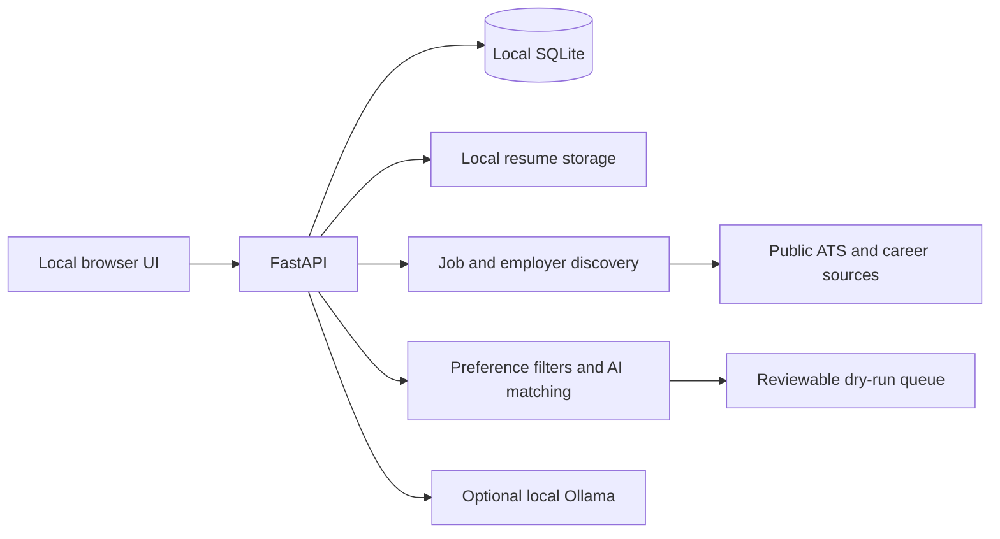

# BabyStepsAI

BabyStepsAI is a local-first job discovery and application preparation prototype for technology careers. It combines resume-based candidate profiles, career preferences, employer job sources, job matching, and a reviewable application queue. Candidate data and the SQLite database are stored locally.

**Live job application submission is disabled.** Application workflows are dry runs; the system does not submit applications to employers.

## Features

- Resume upload and structured profile extraction with candidate review.
- Career preference and location filtering, including an O*NET career catalog.
- Read-only job discovery from supported public ATS feeds and selected public career pages.
- Employer source discovery, provenance, health reporting, and local administration.
- Job normalization, duplicate detection, eligibility matching, and match freshness checks.
- Grounded application answer drafting and a persistent dry-run queue.
- One-prompt workflow orchestration from authorized discovery through eligibility matching and sequential application preparation, with persisted progress and pause/resume/cancel controls.
- Conservative browser preparation that pauses for authentication, CAPTCHA, missing facts, or other human-required steps.
- No paid AI service is required. Ollama can provide local model inference.

## Technology

Python 3.11 or newer, FastAPI, SQLite, Playwright, pypdf, Requests, and Ollama (`qwen2.5:3b` by default). The frontend is served by the FastAPI application.

## Architecture



All administration routes are intended for localhost. This prototype does not provide production multi-user authentication or a public-hosting security model.

## Installation

Use Python 3.11 or newer. From the repository root:

```bash
python3 -m venv .venv
source .venv/bin/activate
python -m pip install --upgrade pip
python -m pip install -r BabyStepsAI_Backend/requirements.txt
python -m playwright install chromium
```

The application can initialize a new empty SQLite database on first import; the local database and candidate files are not part of this repository. Existing local user data is not needed for a fresh clone.

For AI resume extraction and answer drafting, install and run [Ollama](https://ollama.com/) and fetch the configured model:

```bash
ollama pull qwen2.5:3b
ollama serve
```

The default matching provider is local Ollama. Matching supports optional Google Gemini from **Application Settings**; Gemini sends the confirmed candidate profile and saved job content to Google. To use it, set `GEMINI_API_KEY` in the server process environment before startup. The key is never saved in SQLite or returned by the settings API. `GEMINI_MODEL` optionally selects another supported Gemini model; the default is `gemini-2.5-flash`. No API key is required for local Ollama operation, and the server does not automatically load `.env` files.

The workflow dashboard can retry failed saved-job analyses in one matching-only run. It reuses stored openings and does not repeat employer discovery. Provider, model, resume, confirmed profile, preferences, job content, and matching-engine version are tracked for match freshness.

## Run locally

```bash
cd BabyStepsAI_Backend
../.venv/bin/uvicorn main:app --host 127.0.0.1 --port 8000
```

Keep the server bound to `127.0.0.1`. Useful pages:

- Dashboard and resume upload: <http://127.0.0.1:8000/>
- First-time onboarding and reusable application information: <http://127.0.0.1:8000/onboarding>
- Candidate profile: <http://127.0.0.1:8000/candidate-profile>
- Career preferences: <http://127.0.0.1:8000/careers>
- Job discovery: <http://127.0.0.1:8000/find-jobs>
- Unified workflow: <http://127.0.0.1:8000/workflow>
- Employer sources: <http://127.0.0.1:8000/employers>
- Application dry-run queue: <http://127.0.0.1:8000/applications>

### Employer expansion

From `BabyStepsAI_Backend`, run a bounded candidate discovery and source validation pass:

```bash
python expand_employers.py --providers all --limit 20 --seed-limit 100 --batch-size 20 --timeout 20
```

This uses supported candidate providers and saved candidates; Wikidata remains opt-in. Network availability and employer site policies affect live results. Candidates remain inactive until successful live source validation. Expansion is read-only and does not prepare or submit applications.

## Tests and checks

Run the automated Python suite from the backend directory:

```bash
python -m unittest discover -v
python -m py_compile *.py
```

The unified workflow requires automatic discovery and AI matching permissions. Automatic dry-run preparation also requires its separate setting in Application settings. These permissions never enable live employer submission.

Mocked tests use deterministic local responses. Live source verification requires network access and is separate from the test suite.

## Local data and privacy

The root `.gitignore` excludes databases, SQLite journals, resumes, candidate profiles, application history, local screenshots, reports, credentials, and browser state. Do not commit private candidate records or employer verification reports. The app currently uses a single local development identity and stores resume/profile/job/application information in its local database and storage directories.

Sensitive profile and optional demographic fields use Fernet authenticated encryption. By default, the encryption key is stored outside the repository at `~/.config/babystepsai/encryption.key` with owner-only file permissions. Back up this key securely; encrypted values cannot be recovered if the key is lost. `BABYSTEPSAI_ENCRYPTION_KEY` or `BABYSTEPSAI_KEY_PATH` can select a managed key. The application deliberately refuses plaintext fallback when the key cannot be read.

## Limitations

- Public career-page parsing is conservative; unsupported layouts and JavaScript-rendered pages may not yield jobs.
- Provider support is limited to implemented public interfaces and parsers. Workday is not universally supported.
- External site terms, robots rules, rate limits, authentication, and CAPTCHA can prevent discovery or browser preparation.
- AI-generated profile fields and answers require candidate review; generated text is not a verified claim.
- The project is a local prototype, not a multi-user or production-deployment system.
- **Live application submission is disabled.** No UI setting overrides this safeguard.

## Copyright and proprietary use

Copyright © 2026 the BabyStepsAI copyright owner. All rights reserved.

BabyStepsAI is proprietary software. Making this repository publicly visible does not grant permission to copy, modify, redistribute, sublicense, or commercially use the source code. No open-source license is granted or included. All rights not expressly granted in writing by the copyright owner are reserved.

## Third-party data notice

`BabyStepsAI_Backend/career_data/onet/job_titles.csv` contains O*NET 31.0 Job Titles data (54,269 data rows). The O*NET Database is made available under the [Creative Commons Attribution 4.0 International license](https://creativecommons.org/licenses/by/4.0/). This data is credited to the O*NET 31.0 Database and the U.S. Department of Labor, Employment and Training Administration (USDOL/ETA). O*NET® is a trademark of USDOL/ETA; USDOL/ETA has not approved, endorsed, or tested BabyStepsAI. This data notice does not grant any rights to BabyStepsAI's proprietary source code.
